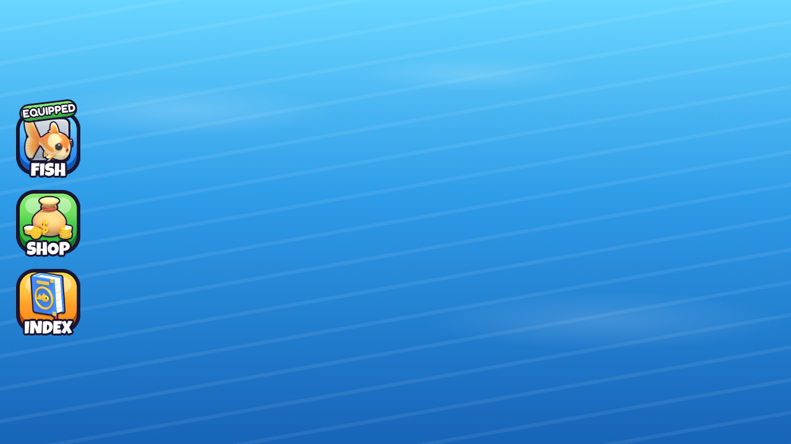
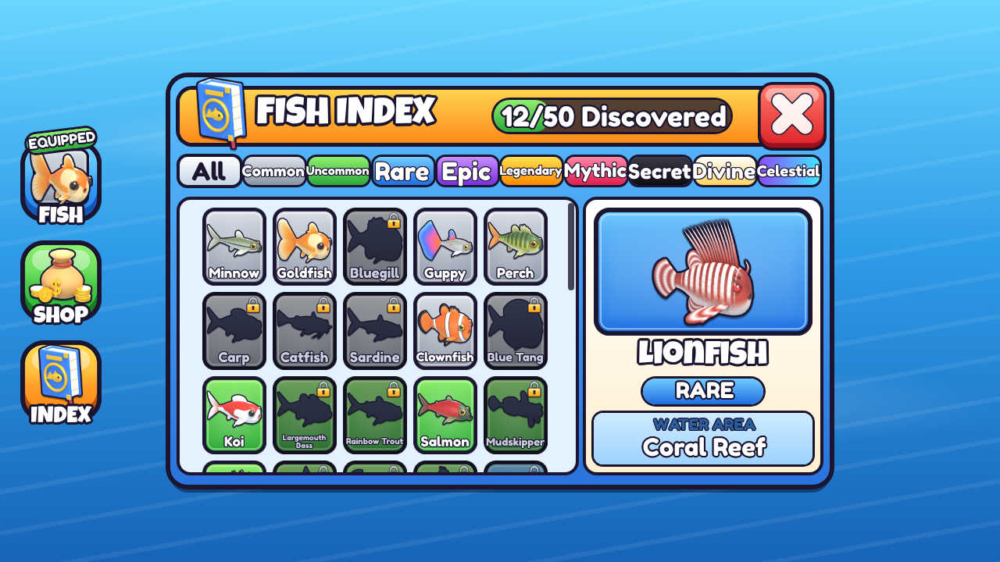

# Fishing UI: HUD buttons + Fish Index

Art assets and a static, importable Roblox layout for three HUD buttons (Fish, Shop, Index) and the Fish Index window. **There are no scripts in this layout.** Opening and closing the window, filling the slots and showing the equipped fish all need scripts, to be written later.




## Files

| Path | What it is |
|---|---|
| `FishingUI.rbxmx` | Roblox model: a `ScreenGui` named `FishingUI` holding `HUDButtons` and `IndexWindow` |
| `asset_map.json` | Maps each PNG (path relative to `ui/`) to the instance paths that display it. An empty list means no instance uses the PNG in the static layout: it is swapped in at runtime (for example the locked thumbnails of discovered fish) |
| `thumbnails/<Name>.png` | 50 fish thumbnails, 256×256, transparent, thick dark outline and soft drop shadow |
| `thumbnails/<Name>_locked.png` | Black silhouette version for undiscovered fish |
| `icons/fish.png`, `shop.png`, `index.png` | 512×512 HUD icons (Goldfish model, coin sack, fish book) |
| `icons/close.png`, `lock.png` | 512×512 close button (complete red button with an X) and padlock |
| `frames/button_{blue,green,orange}.png` | 128×128 chunky HUD button backgrounds (9-slice) |
| `frames/slot_<Rarity>.png` | 96×96 rarity slot frames (9-slice), one per rarity |
| `preview/mockup.html` | HTML mock-up generated from the same layout tree (add `#hud` to the URL to hide the window) |
| `preview/hud.png`, `preview/index.png` | Screenshots of the mock-up at 1280×720 |

The scripts that produce all of this are in `tools/ui/` (see "Regenerating").

## Importing into Studio

1. In the Explorer, right-click **StarterGui**, choose **Insert from File…** and pick `FishingUI.rbxmx`.
2. `IndexWindow` is **visible in the file** so you can inspect it. It is meant to start hidden: set `IndexWindow.Visible = false` (its `StartsHidden` attribute is a reminder) and have a script show it when `HUDButtons.IndexButton` is clicked and hide it from `IndexWindow.Panel.TitleBar.CloseButton`.
3. Images show as blank until you upload the PNGs (next section). The window, tabs, counter, detail panel and badges are native `Frame`/`TextLabel` styling (`UICorner`, `UIStroke`, `UIGradient`), so they render straight away.

The layout has not been opened in Roblox Studio yet. It uses only standard GUI classes and properties, but expect to nudge sizes slightly after the first import.

## Uploading images and filling in the asset IDs

Every image property is set to the placeholder `rbxassetid://0`. Each image instance carries an `AssetFile` string attribute holding its PNG path (relative to `ui/`), and `asset_map.json` lists the same mapping from the PNG side:

```json
"icons/shop.png": ["StarterGui.FishingUI.HUDButtons.ShopButton.Icon"]
```

1. Upload the PNGs with the Asset Manager (bulk import) or Creator Dashboard, then note each ID.
2. For every key in `asset_map.json`, set `Image = "rbxassetid://<id>"` on each listed instance. Alternatively, run a one-off command-bar snippet that walks `FishingUI:GetDescendants()`, reads `inst:GetAttribute("AssetFile")` and looks the ID up in a table you paste in.
3. Slot thumbnails also carry `Unlocked` and `Locked` attributes with both PNG paths. Fish slots (`IndexWindow.Panel.Grid.<FishName>`) carry `FishName`, `DisplayName`, `Rarity`, `WaterArea` and `Discovered` attributes for the scripts that will fill them.

## 9-slice settings

The rbxmx already sets these values (`ScaleType = Slice`):

| Image | Size | SliceCenter | SliceScale used |
|---|---|---|---|
| `frames/button_*.png` | 128×128 | `Rect(40, 40, 88, 82)` (the bottom margin is larger because of the 3D lip) | 1 |
| `frames/slot_*.png` | 96×96 | `Rect(28, 28, 68, 68)` | 0.8 in the grid, 0.6 in the Fish button, 1 in the detail panel |

Thumbnails and icons use `ScaleType = Fit`.

## Rarity colours

| Rarity | Main | Gradient (top → bottom) | Accent |
|---|---|---|---|
| Common | `#B4BCC8` | `#DDE2EA` → `#8A94A4` | `#FFFFFF` |
| Uncommon | `#5BD15B` | `#8EEF6E` → `#2DA83A` | `#D8FFC8` |
| Rare | `#3FA3FF` | `#72CBFF` → `#1E6FE0` | `#D2EEFF` |
| Epic | `#A35BFF` | `#C88EFF` → `#7A2FE0` | `#EBD8FF` |
| Legendary | `#FFB020` | `#FFE04D` → `#FF8A00` | `#FFF4C0` |
| Mythic | `#FF4F7A` | `#FF86A6` → `#E01E4F` | `#FFD6E0` |
| Secret | `#1C1C24` | `#3A3A48` → `#0C0C12` | `#FF2A2A` (red accent) |
| Divine | `#FFF1C4` | `#FFFFFF` → `#FFD45E` | `#FFC22E` |
| Celestial | `#8A4DFF` | `#8A4DFF` → `#3FE6FF` (diagonal on slots, left → right on the tab) | `#FFFFFF` |

The outline colour is `#1B1530` everywhere (UIStroke, icon outlines, frame borders). Fonts are `LuckiestGuy` (titles, HUD labels) and `FredokaOne` (everything else), set through `FontFace`.

## Layout notes

- `HUDButtons` is anchored left-middle (`AnchorPoint 0, 0.5`, 22 px from the left edge) and holds a vertical `UIListLayout` of three 104×104 buttons. The Fish button shows the equipped fish (`EquippedFish` attribute, currently Goldfish) on a rarity slot, with a tilted green **EQUIPPED** badge.
- `IndexWindow` is centred, 66% × 82% of the screen, held to a 1.62 aspect ratio by a `UIAspectRatioConstraint`. It contains a drop `Shadow` and the `Panel`, which holds:
  - `TitleBar`: book icon, "FISH INDEX" title, a `Counter` progress pill ("12/50 Discovered"; `Fill` width = discovered / 50) and `CloseButton`.
  - `Tabs`: All + 9 rarity filter tabs (`TextButton`s with a `Filter` attribute; "All" is styled as selected).
  - `Grid`: a `ScrollingFrame` with a `UIGridLayout` (82×100 cells) and all 50 fish in index order. 12 are shown discovered and 38 locked (silhouette, dimmed frame and padlock). Lionfish is shown selected (yellow stroke).
  - `Details`: the selected fish's big thumbnail on its rarity frame, its name, a rarity pill and the water area.
- Water areas follow the game's 10 zones: Pond, River, Swamp, Coral Reef, Open Ocean, Frozen Sea, Deep Abyss, Volcanic Vent, Sunken Ruins and Starfall Lake. They are set in `AREA` in `tools/ui/fishdata.py`; rebuild with `python3 tools/ui/build_rbxmx.py`.

## Still to do with scripts

- Show and hide `IndexWindow` from the Index and Close buttons.
- Fill each slot from player data: swap `Thumbnail.Image` between the unlocked and locked IDs, toggle `LockIcon`, reset `ImageColor3` to white once discovered, and update the counter text and `Fill` size.
- Apply the tab filters, and update the `Details` panel when a slot is clicked.
- Set the Fish button icon and slot frame to the equipped fish.

## Regenerating

```bash
PY=/tmp/claude-0/bpyenv/bin/python          # Blender 5.3 as a Python module
$PY tools/ui/render_thumbs.py /tmp/ui_raw    # 50 raw renders (Cycles CPU, 20 samples + denoise)
$PY tools/ui/render_icons.py  /tmp/ui_raw    # fish / shop / index icon raw renders
python3 tools/ui/postprocess.py thumbs /tmp/ui_raw ui/thumbnails   # outline, shadow, _locked
python3 tools/ui/postprocess.py icons  /tmp/ui_raw ui/icons
python3 tools/ui/make_frames.py ui           # 9-slice frames + close/lock icons
python3 tools/ui/build_rbxmx.py ui           # FishingUI.rbxmx + asset_map.json (parses the XML as a check)
python3 tools/ui/build_preview.py ui --fonts DIR   # mockup.html + screenshots (DIR holds FredokaOne.woff2 and LuckiestGuy.woff2; without it, Google Fonts is linked)
```

`fishdata.py` holds the fish list, rarity palette, water areas and the demo state (discovered, selected and equipped fish). `uirender.py` holds the shared Blender scene, light and ortho-camera helpers.
